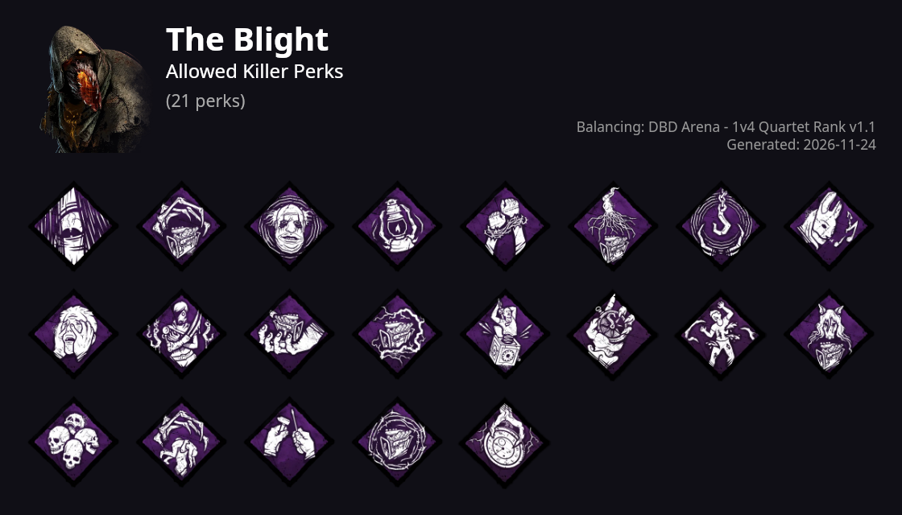
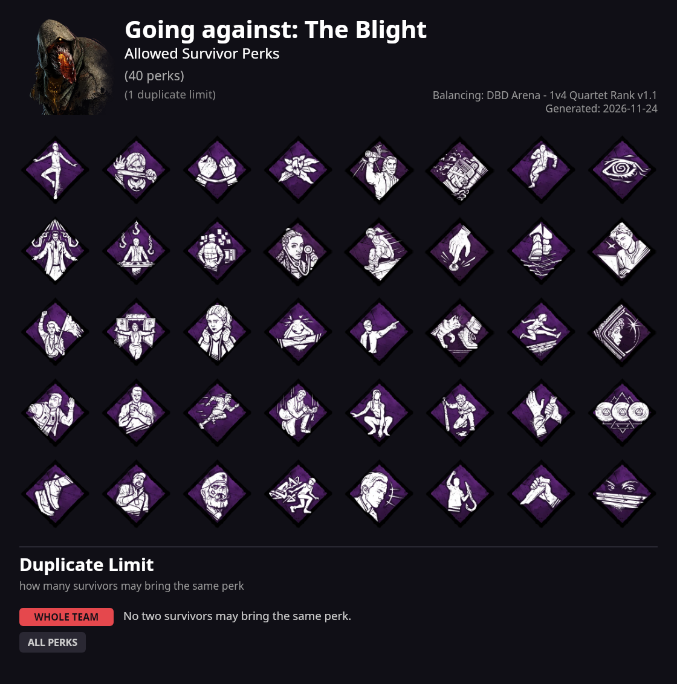
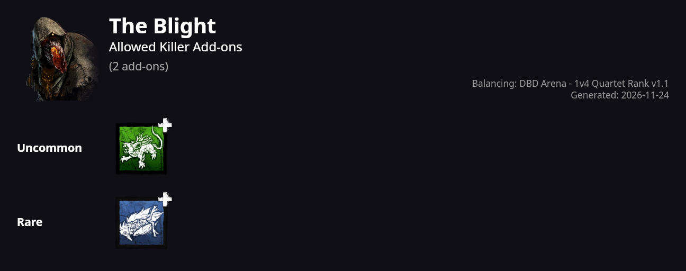
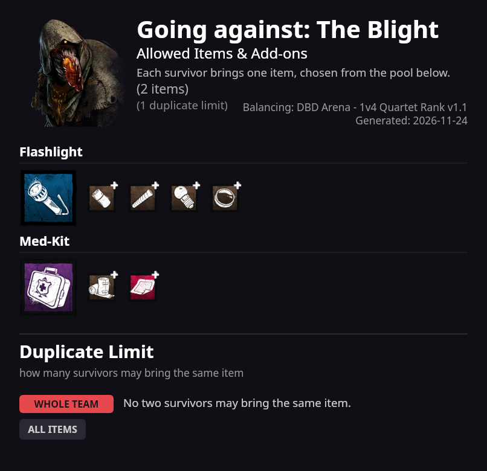
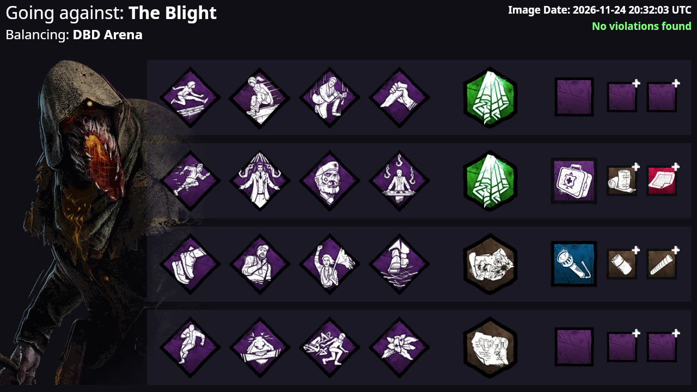
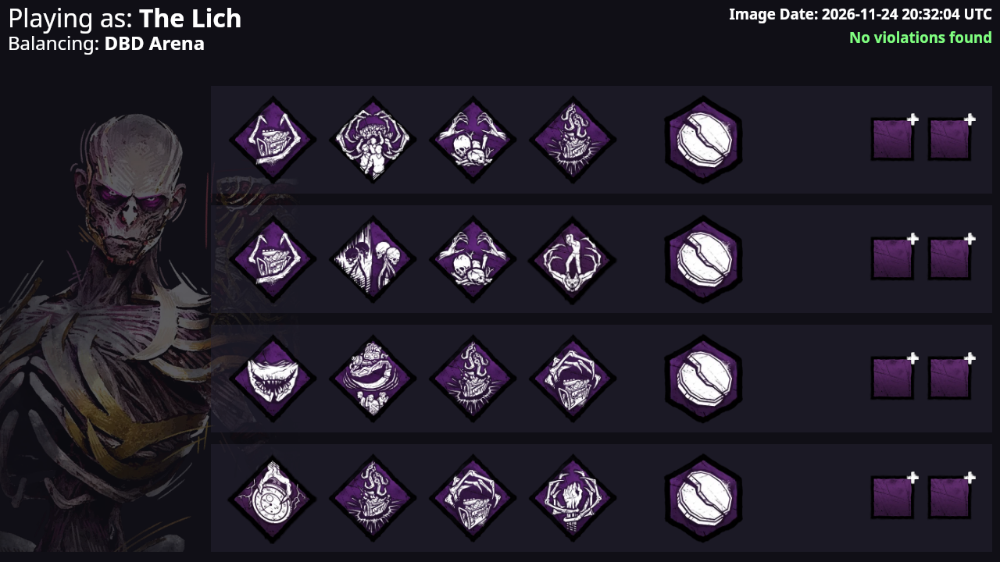
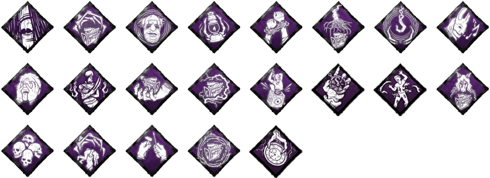
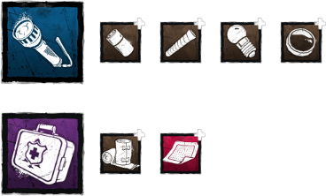

# Sample sheets

What each command produces, rendered from real balancing files borrowed from dbd-arena-web
(1v4 Quartet: The Blight and The Lich). The inputs are in [`input/`](input/), the PNGs in
[`sheets/`](sheets/).

| Input | Role |
|-------|------|
| [`blight-allowlist.yaml`](input/blight-allowlist.yaml) | allow-list for `perks`, `addons`, `items`; `--rules` for the survivor builds |
| [`blight-survivor-builds.yaml`](input/blight-survivor-builds.yaml) | survivor builds (`survivors:`) |
| [`lich-allowlist.yaml`](input/lich-allowlist.yaml) | `--rules` for the killer builds |
| [`lich-killer-builds.yaml`](input/lich-killer-builds.yaml) | killer builds (`builds:`) |

## Running the commands

The tool ships as a Docker image. The commands below run from the repository root with `dbd-sheet`
defined as a shell function around `docker run`:

```bash
dbd-sheet() {
  docker run --rm --user "$(id -u):$(id -g)" -v "$PWD:/work" \
    ghcr.io/shenapse/dbd-balancing-sheet-generator:main "$@"
}
```

The current directory is mounted at `/work`, the image's working directory. Paths therefore stay
relative to it, and the sheets are written to `./output` (or `--out`) as your own user.

## perks

```bash
dbd-sheet perks examples/input/blight-allowlist.yaml --icons-only
```

One sheet per side. Repetition limits (`survivorRepetitionLimits`) are listed under the grid.





## addons

```bash
dbd-sheet addons examples/input/blight-allowlist.yaml --icons-only
```

Allowed power add-ons, grouped by rarity.



## items

```bash
dbd-sheet items examples/input/blight-allowlist.yaml --icons-only
```

Allowed items with their add-ons, plus item duplicate limits (`itemDuplicateLimits`).



## builds

```bash
dbd-sheet builds examples/input/blight-survivor-builds.yaml --rules examples/input/blight-allowlist.yaml
dbd-sheet builds examples/input/lich-killer-builds.yaml     --rules examples/input/lich-allowlist.yaml
```

One row per build (perks, offering, item and add-ons). With `--rules`, the top right says whether
any build breaks the allow-list.





## Icon-only variants (`--icons-only`)

`perks`, `addons` and `items` also write text-free sheets next to the regular ones:

| Killer perks | Survivor perks | Add-ons | Items |
|---|---|---|---|
|  |  |  |  |

## Regenerating

```bash
examples/generate.sh                      # pulls and runs ghcr.io/shenapse/dbd-balancing-sheet-generator:main
BSG_IMAGE=bsg:dev examples/generate.sh    # runs a locally built image instead
```

The script runs each command above through Docker and writes the results to `sheets/`. The sheets use
the dbd-assets commit baked into the image, which the script prints first. They carry the
generation date, so regenerating changes every PNG. To render with uncommitted source
changes, build `bsg:dev` first (see the README's "Local image build").
The same inputs are also golden regression cases (see the README's "Regression tests").
